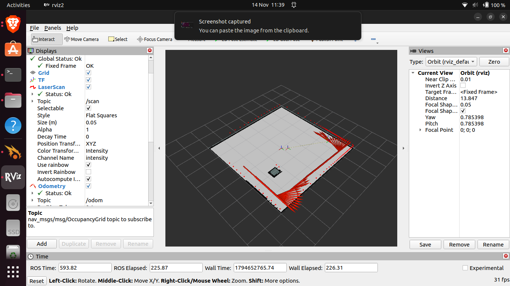

# Robot mobile différentiel : ROS 2 Humble + Gazebo Fortress

Simulation d'un robot mobile à deux roues motrices, conçu entièrement à partir
de zéro (modèle SDF, monde, lidar, nœuds ROS 2) : piloté depuis ROS 2 via
`ros_gz_bridge`, il évite les obstacles et cartographie son environnement avec
SLAM Toolbox. Aucun robot réel n'est nécessaire.

## Fonctionnalités
- Modèle de robot différentiel (châssis, 2 roues motrices, 2 roues folles, lidar)
- Monde de simulation : pièce de 6 x 6 m avec un obstacle
- Pont ROS 2 ↔ Gazebo (`/cmd_vel`, `/odom`, `/scan`, `/tf`, `/clock`)
- Évitement d'obstacles avec lidar 2D (machine à états avec hystérésis)
- Arbre TF complet (`map → odom → base_link → lidar`)
- Cartographie SLAM (SLAM Toolbox) et sauvegarde de la carte
- À venir : navigation autonome avec Nav2

## Aperçu


## Architecture
```
Gazebo Fortress (physique, robot, lidar)
      |  /scan, /odom, /tf, /clock     ^  /cmd_vel
      v                                |
              ros_gz_bridge
      |                                ^
      v                                |
ROS 2 Humble : obstacle_avoider, slam_toolbox
```

| Topic | Type | Sens |
|---|---|---|
| `/cmd_vel` | `geometry_msgs/Twist` | ROS 2 → Gazebo |
| `/odom` | `nav_msgs/Odometry` | Gazebo → ROS 2 |
| `/scan` | `sensor_msgs/LaserScan` | Gazebo → ROS 2 |
| `/tf` | `tf2_msgs/TFMessage` | Gazebo → ROS 2 (odom → base_link) |
| `/clock` | `rosgraph_msgs/Clock` | Gazebo → ROS 2 |
| `/map` | `nav_msgs/OccupancyGrid` | SLAM Toolbox → ROS 2 |

Arbre TF :
```
map -> odom -> base_link -> mon_robot/lidar_link/lidar
SLAM   DiffDrive            static_transform_publisher
```

## Structure du dépôt
```
robot_basics/
├── models/robot.sdf          # robot : châssis, roues, lidar, plugin DiffDrive
├── worlds/mon_monde.sdf      # monde : sol, murs, obstacle, plugins système
├── launch/
│   ├── robot.launch.py       # Gazebo + bridge + transform statique du lidar
│   └── slam.launch.py        # SLAM Toolbox
├── config/slam_params.yaml   # paramètres du SLAM
├── maps/                     # cartes sauvegardées (.pgm + .yaml)
├── robot_basics/
│   ├── driver_node.py        # avance jusqu'à x = 2 m en lisant /odom
│   └── obstacle_avoider.py   # évitement d'obstacles avec /scan
├── docs/                     # captures d'écran
├── NOTES.md                  # notes d'apprentissage
└── setup.py / package.xml
```

## Prérequis
- Ubuntu 22.04, ROS 2 Humble, Gazebo Fortress (`ign gazebo`)
```bash
sudo apt install ros-humble-ros-gz ros-humble-slam-toolbox \
  ros-humble-nav2-map-server ros-humble-tf2-tools ros-humble-rviz2
```

## Installation
```bash
mkdir -p ~/maram_ws/src && cd ~/maram_ws/src
git clone https://github.com/maram-el-hadj/ros2-gazebo-mobile-robot.git robot_basics
cd ~/maram_ws
colcon build --symlink-install --packages-select robot_basics
source install/setup.bash
```

## Utilisation
Chaque terminal doit d'abord charger ROS 2 et le workspace (`source`).

1. Simulation + bridge + TF :
```bash
ros2 launch robot_basics robot.launch.py
```
2. SLAM :
```bash
ros2 launch robot_basics slam.launch.py
```
3. Faire bouger le robot (évitement automatique) :
```bash
ros2 run robot_basics obstacle_avoider
```
4. Visualiser (Fixed Frame = `map`, ajouter Map `/map`, TF, LaserScan `/scan`) :
```bash
ros2 run rviz2 rviz2 --ros-args -p use_sim_time:=true
```
5. Sauvegarder la carte :
```bash
ros2 run nav2_map_server map_saver_cli -f ~/maram_ws/src/robot_basics/maps/mon_monde
```

Alternative au pilotage automatique : `ros2 run teleop_twist_keyboard teleop_twist_keyboard`
(ne pas lancer en même temps qu'`obstacle_avoider` : tous deux publient sur `/cmd_vel`).

Nœud de test (`/odom`, s'arrête à x = 2 m) : `ros2 run robot_basics driver_node`.

## Choix techniques
- **`ogre2`** pour `gpu_lidar` (avec `ogre`, les mesures étaient fausses).
- **Stabilité** : deux roues folles, châssis bas et lourd, inerties explicites, accélérations limitées.
- **Performance** : pas de temps 4 ms, lidar 120 rayons, ombres désactivées.
- **Évitement** : 3 secteurs, seuils 0.7 m / 0.95 m (hystérésis), direction choisie une fois par virage.
- **TF** : `odom → base_link` publié par DiffDrive, `base_link → lidar` statique, `map → odom` par SLAM.
- **SLAM** : `async_slam_toolbox_node`, résolution 5 cm, une mise à jour toutes les 0.5 s.

## Limites connues
- Chemins absolus dans `worlds/mon_monde.sdf` et `robot.launch.py`.
- `/scan` est publié plus vite que les 10 Hz demandés (limité côté SLAM).
- La dérive d'odométrie augmente quand le robot tourne vite.

## Roadmap
- [x] Étape 1 : robot différentiel (SDF + DiffDrive)
- [x] Étape 2 : monde, murs, obstacle, launch file
- [x] Étape 3 : bridge ROS 2 ↔ Gazebo, nœud de contrôle
- [x] Étape 4 : lidar + évitement d'obstacles
- [x] Étape 5 : TF, odométrie, horloge de simulation
- [x] Étape 6 : SLAM Toolbox (cartographie)
- [ ] Étape 7 : navigation autonome avec Nav2
- [ ] Chemins portables

## Auteur
Maram El Hadj : [GitHub](https://github.com/maram-el-hadj)
